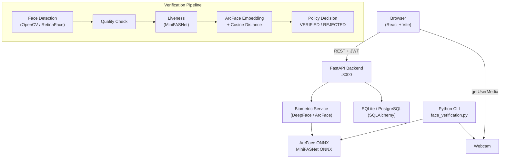

# FaceVerification AI

**Adaptive Biometric Trust Platform**


A full-stack biometric identity verification platform built on ArcFace face recognition and passive liveness detection. Includes a React web dashboard, FastAPI backend, encrypted biometric storage, and a standalone Python CLI.

> **Important:** This is a research and development platform. Read the [Security Model](#security-architecture) and [Known Limitations](#known-limitations) sections before any deployment.

---

## Table of Contents

- [Overview](#overview)
- [Features](#features)
- [Architecture](#architecture)
- [Technology Stack](#technology-stack)
- [Project Structure](#project-structure)
- [How It Works](#how-it-works)
- [Getting Started](#getting-started)
- [Configuration](#configuration)
- [Running the Application](#running-the-application)
- [Running Tests](#running-tests)
- [API Reference](#api-reference)
- [Security Architecture](#security-architecture)
- [Privacy and Biometric Data](#privacy-and-biometric-data)
- [Known Limitations](#known-limitations)
- [Roadmap](#roadmap)
- [Contributing](#contributing)
- [License](#license)

---

## Overview

FaceVerification AI provides a complete biometric verification workflow:

1. An administrator registers users and records explicit biometric consent.
2. A user enrolls their face — the system detects the face, assesses quality, runs passive liveness detection, and generates an ArcFace embedding encrypted at rest.
3. During a verification session, live webcam frames are analyzed server-side: face detection → liveness check → ArcFace comparison → verification decision.
4. All decisions are logged. The dashboard shows real-time statistics, verification history, and security events.

The web platform wraps a standalone Python v1.3 CLI that operates independently of the web stack.

**Real-world use cases (research/prototype contexts):**
- Access control prototyping
- Identity verification research
- Biometric pipeline evaluation
- Liveness and anti-spoofing research

---

## Features

### Web Platform (v2.0)

| Feature | Status |
|---|---|
| Admin authentication (JWT, bcrypt) | Complete |
| Role-based access control (Admin / Operator / Viewer) | Complete |
| Multi-user registration and management | Complete |
| Consent-based facial enrolment | Complete |
| ArcFace embedding generation (ONNX) | Complete |
| Fernet encryption of stored embeddings | Complete |
| Live browser webcam verification | Complete |
| Passive liveness detection (MiniFASNet) | Complete |
| Adaptive verification policy engine | Complete |
| Explainable verification results | Complete |
| Verification history (paginated) | Complete |
| Dashboard with real DB statistics | Complete |
| Analytics charts (Recharts) | Complete |
| Security event feed | Complete |
| Admin settings API | Complete |
| 102 automated tests | Complete |

### Standalone CLI (v1.3)

| Feature | Status |
|---|---|
| Webcam face verification | Complete |
| ArcFace recognition | Complete |
| Passive anti-spoofing | Complete |
| 10-state verification state machine | Complete |
| Background inference thread | Complete |
| FPS / latency HUD overlay | Complete |

---

## Architecture



### Threading model (CLI)

The standalone CLI keeps the display loop independent of inference:

```
Main thread (display)          InferenceWorker thread
──────────────────────         ──────────────────────
cap.read() → frame     ──────▶ wait(frame_event)
push_frame()                   _process():
result_queue.get_nowait() ◀─── extract_faces (liveness)
state_mgr.tick()               DeepFace.verify()
draw_overlay()          ◀───── result_queue.put()
cv2.imshow()
```

---

## Technology Stack

**Backend**

| Component | Technology |
|---|---|
| API framework | FastAPI |
| ORM | SQLAlchemy |
| Database | SQLite (dev) / PostgreSQL (prod) |
| Authentication | JWT (python-jose) + bcrypt (passlib) |
| AI / CV | DeepFace 0.0.102 (ONNX) |
| Recognition model | ArcFace |
| Liveness model | MiniFASNetV2 + MiniFASNetV1SE |
| Face detection | OpenCV Haar cascade (default) |
| Embedding encryption | Fernet (cryptography) |

**Frontend**

| Component | Technology |
|---|---|
| Framework | React 19 |
| Language | TypeScript |
| Build | Vite |
| Styling | Tailwind CSS |
| HTTP client | Axios + TanStack Query |
| Charts | Recharts |
| Auth state | Zustand |

**Development**

| Component | Technology |
|---|---|
| Python tests | pytest |
| Test DB | SQLite in-memory (StaticPool) |
| Python version | 3.10+ |
| Node version | 18+ |

---

## Project Structure

```
FaceVerification/
├── face_verification.py      # v1.3 standalone CLI entry point
├── face-recognition.py       # Original 44-line prototype (preserved)
├── app/                      # v1.3 Python package
│   ├── config.py             # AppConfig dataclass
│   ├── state_manager.py      # 10-state verification state machine
│   ├── inference_worker.py   # Background DeepFace thread
│   ├── overlay.py            # HUD rendering
│   └── camera.py             # VideoCapture lifecycle
├── backend/                  # FastAPI backend (v2.0)
│   ├── main.py               # App entry point
│   ├── config.py             # Pydantic settings
│   ├── database.py           # SQLAlchemy engine + session
│   ├── models/               # ORM models
│   ├── schemas/              # Pydantic request/response schemas
│   ├── routers/              # API route handlers
│   ├── services/             # Business logic
│   │   ├── biometric_service.py   # DeepFace wrapper
│   │   └── auth_service.py        # JWT + password hashing
│   └── tests/                # Backend pytest suite
├── frontend/                 # React web dashboard (v2.0)
│   ├── src/
│   │   ├── pages/            # 9 pages
│   │   ├── api/              # API client + hooks
│   │   ├── components/       # Shared UI components
│   │   └── store/            # Zustand auth state
│   └── package.json
├── tests/                    # v1.3 CLI pytest suite (75 tests)
├── docs/                     # Documentation
│   ├── ARCHITECTURE_V2.md
│   ├── SECURITY_MODEL.md
│   ├── DATABASE_DESIGN.md
│   ├── LOCAL_SETUP_WINDOWS.md
│   ├── BIOMETRIC_VALIDATION.md
│   └── IMPLEMENTATION_STATUS.md
├── .env.example              # Environment variable template
├── start_backend.ps1         # Backend startup script
├── start_frontend.ps1        # Frontend startup script
└── requirements.txt          # v1.3 CLI dependencies
```

---

## How It Works

### Enrolment

```
1. Admin creates user account
2. User provides explicit biometric consent (recorded with timestamp)
3. Webcam captures facial image
4. Server validates: single face, quality score ≥ 0.6, liveness passes
5. ArcFace generates a 512-dimensional embedding
6. Embedding is encrypted with Fernet (key from EMBEDDING_ENCRYPTION_KEY)
7. Encrypted blob stored in database — raw embedding never returned via API
```

### Verification

```
1. Client requests a session (session_id, 120s expiry, max 10 attempts)
2. Client captures webcam frame (JPEG) and sends to server
3. Server pipeline:
   a. Face detection (OpenCV)
   b. Face count: 0 → NO_FACE, >1 → MULTIPLE_FACES
   c. Quality assessment (sharpness, brightness, face area)
   d. Liveness check (MiniFASNet) → SPOOF_DETECTED on fail
   e. ArcFace embedding → cosine distance vs enrolled embedding
   f. Distance ≤ threshold (0.68) → VERIFIED, else REJECTED
4. Result returned with explanation and session state
5. Event logged to database
```

### Fail-closed security

Any step that fails or raises an exception produces a **non-authenticated** result. The only path to `VERIFIED` is completing all steps successfully. A `VERIFIED` result expires after a configurable timeout (default 1500ms in CLI, 120s session in web).

---

## Getting Started

### Prerequisites

- Windows 10 / 11 (Linux/macOS also supported with minor path changes)
- Python 3.10+
- Node.js 18+
- Git
- Webcam (for live verification)

### Clone

```powershell
git clone https://github.com/TechieTojin/FaceVerification.git
cd FaceVerification
```

### Python environment

```powershell
python -m venv .venv
.\.venv\Scripts\Activate.ps1

# v1.3 CLI dependencies
pip install -r requirements.txt

# v2.0 backend dependencies
pip install -r backend\requirements_backend.txt
```

### Node dependencies

```powershell
cd frontend
npm install
cd ..
```

### Environment configuration

```powershell
Copy-Item .env.example .env
```

Edit `.env` — the minimum required settings:

```env
# Your reference face image (for the CLI only)
REFERENCE_IMAGE_PATH=C:\path\to\your_face.jpg

# Admin account created on first backend startup
INITIAL_ADMIN_EMAIL=admin@yourdomain.local
INITIAL_ADMIN_PASSWORD=<choose a strong password>

# JWT signing secret
SECRET_KEY=<output of: python -c "import secrets; print(secrets.token_hex(32))">

# Embedding encryption key
EMBEDDING_ENCRYPTION_KEY=<output of: python -c "from cryptography.fernet import Fernet; print(Fernet.generate_key().decode())">
```

---

## Configuration

All settings are loaded from `.env`. See `.env.example` for the full reference.

| Variable | Default | Description |
|---|---|---|
| `REFERENCE_IMAGE_PATH` | — | CLI: path to reference face image |
| `INITIAL_ADMIN_EMAIL` | — | Admin email for first-run seeding |
| `INITIAL_ADMIN_PASSWORD` | — | Admin password (required, no default) |
| `SECRET_KEY` | random | JWT signing key — set explicitly in production |
| `EMBEDDING_ENCRYPTION_KEY` | — | Fernet key for embedding encryption |
| `DATABASE_URL` | `sqlite:///./faceverification.db` | SQLAlchemy connection string |
| `ENABLE_LIVENESS` | `true` | Enable passive anti-spoofing |
| `RECOGNITION_MODEL` | `ArcFace` | DeepFace model |
| `DETECTOR_BACKEND` | `opencv` | Face detector |
| `INFERENCE_INTERVAL_MS` | `500` | CLI: ms between inferences |
| `RESULT_EXPIRY_MS` | `1500` | CLI: VERIFIED state lifetime |
| `LOG_LEVEL` | `INFO` | Logging verbosity |

---

## Running the Application

### Backend (FastAPI)

```powershell
# Terminal 1
.\.venv\Scripts\Activate.ps1
.\.venv\Scripts\python.exe -m uvicorn backend.main:app --port 8000 --reload
```

Or use the startup script:

```powershell
.\start_backend.ps1
```

Backend available at:
- API: http://localhost:8000/api/v1/
- Interactive docs: http://localhost:8000/docs

### Frontend (React)

```powershell
# Terminal 2
cd frontend
.\node_modules\.bin\vite.cmd --port 5173
```

Or:

```powershell
.\start_frontend.ps1
```

Frontend available at: http://localhost:5173

### Standalone CLI (v1.3)

The original Python CLI works independently of the web stack:

```powershell
.\.venv\Scripts\Activate.ps1
python face_verification.py --reference "C:\path\to\photo.jpg"

# Options
python face_verification.py --help
python face_verification.py --reference PATH --camera INDEX
```

Press **Q** or **ESC** to exit. On first run, ArcFace (~137 MB) and anti-spoofing models (~4 MB) download automatically.

---

## Running Tests

```powershell
.\.venv\Scripts\Activate.ps1

# All tests (102)
.\.venv\Scripts\python.exe -m pytest backend/tests/ tests/ -v

# Backend only (27)
.\.venv\Scripts\python.exe -m pytest backend/tests/ -v

# v1.3 CLI only (75)
.\.venv\Scripts\python.exe -m pytest tests/ -v
```

Test summary:

| Suite | Tests | Description |
|---|---|---|
| `tests/` | 75 | v1.3 CLI: state machine, security, config, inference, overlay |
| `backend/tests/` | 27 | API auth, users, enrolment, verification, dashboard |
| **Total** | **102** | All using SQLite in-memory; no webcam or model required |

---

## API Reference

Full interactive documentation: http://localhost:8000/docs (Swagger UI)

Selected endpoints:

| Method | Path | Auth | Description |
|---|---|---|---|
| `GET` | `/api/v1/health` | None | Service health check |
| `POST` | `/api/v1/auth/login` | None | Obtain JWT token |
| `POST` | `/api/v1/auth/logout` | JWT | Invalidate session |
| `GET` | `/api/v1/auth/me` | JWT | Current user |
| `GET` | `/api/v1/users` | Admin | List users |
| `POST` | `/api/v1/users` | Admin | Create user |
| `POST` | `/api/v1/enrolments/{id}/consent` | Admin | Record biometric consent |
| `POST` | `/api/v1/enrolments/{id}/enrol` | Admin | Enrol face (upload image) |
| `DELETE` | `/api/v1/enrolments/{id}` | Admin | Revoke enrolment |
| `POST` | `/api/v1/verification/sessions` | JWT | Start verification session |
| `POST` | `/api/v1/verification/sessions/{id}/submit-frame` | JWT | Submit webcam frame |
| `GET` | `/api/v1/dashboard/summary` | JWT | Dashboard statistics |
| `GET` | `/api/v1/analytics` | JWT | Analytics data |
| `GET` | `/api/v1/verification/events` | JWT | Verification history |
| `GET` | `/api/v1/security/events` | JWT | Security audit log |
| `GET/PUT` | `/api/v1/settings` | Admin | Application settings |

---

## Security Architecture

### What is implemented

| Control | Description |
|---|---|
| Fail-closed state machine | Every error path produces a non-authenticated result |
| Passive liveness (MiniFASNet) | Rejects many printed photos and screen replays |
| Multiple-face rejection | Prevents simultaneous presentation attacks |
| Result expiry | VERIFIED state has a bounded lifetime |
| JWT authentication | HS256 tokens, configurable expiry |
| bcrypt password hashing | Work factor 12 |
| Fernet embedding encryption | AES-128-CBC; key managed via env var |
| Consent recording | Timestamp and flag stored per enrolment |
| Role-based access | Admin / Operator / Viewer |
| No embedding exposure | Raw vectors never returned via API |
| Audit logging | Verification events and security events persisted |

### What is NOT implemented or validated

| Gap | Notes |
|---|---|
| Virtual camera injection | An attacker with local access can feed synthetic video |
| 3D mask attacks | RGB-only liveness cannot detect silicone masks |
| High-quality photo spoofing | Passive PAD tested on low-quality prints only |
| Alembic migrations | `create_all()` used — no migration history |
| Per-request HTTP rate limiting | Session-level attempt limit only |
| HTTPS enforcement | HTTP in development mode |
| Account lockout after repeated failures | Logged but not automatically locked |

### Liveness limitation (important)

The passive anti-spoofing model (MiniFASNet) is trained to detect printed photos and screen replays under typical conditions. It has not been independently validated against high-quality photo attacks, adversarial examples, or 3D masks. Do not rely on it as the sole barrier for high-stakes authentication.

---

## Privacy and Biometric Data

- Facial embeddings are stored encrypted (Fernet, key in `.env`).
- The encryption key is never logged or returned by the API.
- Raw video frames are not stored.
- Biometric consent is recorded with a timestamp before any enrolment.
- Enrolments can be fully deleted via the API (embedding and consent records removed).
- No biometric data is transmitted to third-party services.
- Applicable laws (GDPR, BIPA, CCPA, etc.) require legal review before deployment.

---

## Known Limitations

1. **SQLite only tested locally.** PostgreSQL is supported via `DATABASE_URL` but not tested.
2. **No database migration tooling.** Schema changes require manual migration or a fresh database.
3. **Passive liveness is not independently validated.** Do not claim spoof resistance without physical testing.
4. **Windows-first development.** Linux/macOS paths in docs may need adjustment.
5. **No HTTPS in development.** Production deployments require TLS.
6. **Single reference image per user.** Multi-sample enrolment not implemented.
7. **No demographic bias evaluation.** ArcFace accuracy varies across populations.
8. **Camera index 0 assumed.** Multi-camera selection not implemented in CLI.

---

## Screenshots

Screenshots are pending manual capture from the running application.
See [`docs/screenshots/README.md`](docs/screenshots/README.md) for capture instructions.

---

## Roadmap

- [ ] Alembic database migrations
- [ ] PostgreSQL integration testing
- [ ] Per-request rate limiting middleware
- [ ] Account lockout after repeated failed attempts
- [ ] Multi-sample enrolment (average embedding)
- [ ] Active liveness challenges (head movement)
- [ ] Independent anti-spoofing evaluation
- [ ] HTTPS / TLS setup guide
- [ ] Docker Compose configuration
- [ ] Demographic accuracy evaluation
- [ ] Reference embedding re-encryption on key rotation
- [ ] Playwright end-to-end tests

---

## Contributing

Contributions are welcome. Please read [CONTRIBUTING.md](CONTRIBUTING.md) before opening a pull request.

**Before contributing:**
- Do not commit `.env` files, real biometric data, or face images.
- Do not weaken verification thresholds without documented justification.
- All new features must include tests.
- Security-sensitive changes require a description of the threat model impact.

---

## License

MIT License — see [LICENSE](LICENSE) if present.

---

## Acknowledgements

- [DeepFace](https://github.com/serengil/deepface) — face recognition and liveness framework
- [ArcFace](https://arxiv.org/abs/1801.07698) — recognition model
- [MiniFASNet](https://github.com/minivision-ai/Silent-Face-Anti-Spoofing) — passive anti-spoofing
- [FastAPI](https://fastapi.tiangolo.com) — backend framework
- [Labeled Faces in the Wild](http://vis-www.cs.umass.edu/lfw/) — used for automated integration testing
