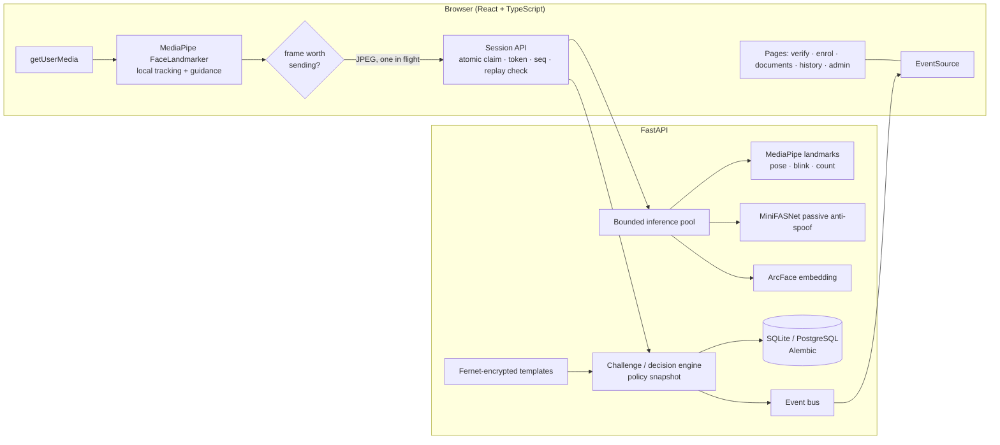

# FaceVerification 4.0

Supervised biometric **1:1 face verification** and identity management: an operator verifies that the person in front of a camera is the enrolled user they selected. The server issues a randomised liveness challenge, validates the evidence itself, compares an ArcFace embedding with an encrypted reference template and records an auditable decision.

> **Read [Security model & limitations](#security-model--limitations) before deploying.** A browser cannot prove that video comes from a physical camera, and no accuracy or anti-spoofing figures are claimed for this system beyond what is measured with your own labelled data.

Version 4.0 adds multi-organisation tenancy, passkeys and multi-factor sign-in, QR / phone verification, camera
and device management, a manual review queue, a notification centre, an integration API with signed results and
a TypeScript SDK, and an offline kiosk agent — see [docs/V4_FEATURES.md](docs/V4_FEATURES.md).

The repository also contains the original prototype (`face-recognition.py`, kept for history) and the v1.3 desktop CLI ([CLI section](#desktop-cli-v13)), both unchanged.

---

## Contents
- [What it does](#what-it-does)
- [Architecture](#architecture)
- [How a verification decision is made](#how-a-verification-decision-is-made)
- [Getting started](#getting-started)
- [Running tests](#running-tests)
- [Configuration](#configuration)
- [Security model & limitations](#security-model--limitations)
- [Desktop CLI (v1.3)](#desktop-cli-v13)
- [Further documentation](#further-documentation)

## What it does

| Area | Capability |
|---|---|
| Live verification | Camera device selection, in-browser MediaPipe face tracking with real bounding boxes and landmarks, live guidance (closer / back / lighting / pose / one person), server-generated randomised challenge (look straight → blink / turn left / turn right → look straight), passive MiniFASNet anti-spoofing, ArcFace matching at start **and** end of the challenge. |
| Enrolment | Wizard: subject → authorisation preview → consent attested by the **subject's own password** → liveness challenge + multi-sample capture → consistency check → duplicate check → active template or **pending admin approval** (replacement, suspected duplicate, operator self-enrolment). |
| Identity management | Users CRUD, roles, disable/enable, password reset, search/filter/pagination, enrolment record, consent history, revoke, re-enrolment request, approvals queue, four-eyes option, per-user audit trail. |
| RBAC | `ADMIN`, `OPERATOR`, `VIEWER` with a single server-side permission map (`backend/core/permissions.py`); the UI only reflects the permissions `/auth/me` returns. |
| Sessions | Ownership, expiry, inactivity timeout, cancellation, one in-flight frame per session (atomic claim), one-time frame tokens + sequence numbers, exact-replay rejection, frozen-feed termination, network-recovery resync, maintenance job that closes abandoned sessions. |
| Policy | Versioned, validated, audited admin settings that **actually drive** the pipeline (thresholds, liveness, attempts, timeouts, quality, capture, alerts, retention). Running sessions keep the policy snapshot they started with; weakening changes require confirmation and a reason. |
| Monitoring | Live dashboard (SSE with heartbeat, reconnect and stale indicator), real DB/model/migration health, suspicious-activity alerts with acknowledge/resolve, security event log, admin audit log. |
| History | Session history with filters, sorting, detail view (challenge steps, per-frame events, policy snapshot) and CSV export (formula-injection safe). Scores are visible only to roles with `history:scores`. |
| Documents | Live face ↔ document portrait match. Document **authenticity** is a separate field that is `NOT_PERFORMED` unless a provider is configured; the overall decision is "identity verified" only when both pass. Document images are never stored; the portrait template is purged after use. |
| Analytics | Latency p50/p95/p99, completion/verified/liveness-rejection/quality-failure/error rates, throughput, trends. An evaluation module computes **FAR / FRR / EER** only from labelled datasets you upload. |
| Organisations (v4) | Tenants with per-organisation roles, policies and data; organisation switcher; invitations; platform administrators create/suspend organisations. Every query is scoped to the active organisation, re-validated on each request. |
| Sign-in (v4) | Passkeys (WebAuthn, usernameless), optional live face check *after* a passkey, authenticator apps (TOTP), email codes (when SMTP is configured), recovery codes, policy-required MFA for administrators, step-up for sensitive actions (face + factor for high-risk ones when enabled). |
| Cross-device (v4) | QR pairing with an operator-confirmed code; the person verifies on their own phone while the desktop follows live; hosted links for the integration API. |
| Operations (v4) | Registered cameras with heartbeats; devices with key-based provisioning, signed requests and revocation; review queue for borderline/low-confidence/spoof cases; notification centre with optional email. |
| Integrations (v4) | Scoped API credentials, hosted verification sessions, ES256-signed assertions + JWKS, signed webhooks with retries, idempotency; server-side TypeScript SDK in `sdk/typescript`. |
| Offline kiosk (v4) | `python -m kiosk`: local inference with the same models, encrypted provisioned templates for explicitly authorised people, bounded validity, hash-chained audit queue with idempotent sync. |

## Architecture



* **Transport:** HTTP multipart frames with server-enforced backpressure (exactly one frame in flight per session). Chosen over WebSockets because it reuses cookie + CSRF authentication, gives atomic per-frame state transitions in the database and is easy to test. Live dashboards use Server-Sent Events.
* **Inference never runs on the event loop:** a fixed worker pool with non-blocking admission returns `503 Retry-After` when saturated.
* **All decisions are server-side.** The browser's tracker only provides guidance and avoids uploading obviously unusable frames.

Key code: `backend/services/biometric/engine.py` (state machine), `backend/services/capture_service.py` (session protocol), `backend/services/biometric/providers.py` (models), `backend/services/policy_service.py`, `frontend/src/features/camera/` (camera, tracker, guidance, capture loop).

## How a verification decision is made

1. The operator picks an enrolled user. The server checks consent and template usability, rate-limits the operator, snapshots the active policy and returns a random challenge plus a one-time frame token.
2. Each frame is claimed atomically (`active`, matching token, expected sequence, nothing in flight, frame budget left), decoded safely, checked against recent frame digests, then analysed on the inference pool.
3. **Look straight** (2 consecutive frontal frames passing the quality gate) → passive anti-spoof → embedding.
4. **Random actions**: turns must move ≥ 75 % of the policy angle from the step's starting yaw in the requested direction (turning the wrong way fails the round); a blink needs an open-eyes frame followed by both eyes closing. Each step has a timeout; abrupt face jumps or a second face restart the round.
5. **Look straight** again → passive anti-spoof → embedding. Only now is identity decided: the maximum cosine distance of the opening and closing embeddings must be ≤ the policy threshold (default 0.68, DeepFace's published ArcFace value — not calibrated for your population).
6. Failed rounds consume attempts and issue a *new* random challenge. Terminal outcomes: `VERIFIED`, `NOT_MATCHED`, `LIVENESS_FAILED`, `SESSION_EXPIRED`, `SESSION_CANCELLED`, `ATTEMPTS_EXHAUSTED`, `ERROR` (`ENROLMENT_CAPTURED` for enrolment). Per-frame: `IN_PROGRESS`, `RETRY_REQUIRED`, `NO_FACE`, `MULTIPLE_FACES`, `QUALITY_FAILED`.

Cosine distance is a dissimilarity score, **not** a probability that two faces belong to the same person.

## Getting started

Prerequisites: Python 3.10, Node 22+, ~1 GB disk for model weights.

```powershell
# 1. Python environment (never install into the global interpreter)
python -m venv .venv
.venv\Scripts\pip install -r backend\requirements_backend.txt
.venv\Scripts\pip install --no-deps -r backend\requirements_mediapipe.txt

# 2. Model files (MediaPipe landmarker, SHA-256 verified; DeepFace weights download on first start)
.venv\Scripts\python scripts\fetch_models.py

# 3. Configuration
copy .env.example .env
#   set SECRET_KEY, EMBEDDING_ENCRYPTION_KEY, INITIAL_ADMIN_PASSWORD (commands are in .env.example)

# 4. Frontend dependencies
cd frontend; npm install; cd ..
```

Upgrading from 3.0: the start-up migration `0003_v4_platform` (after a SQLite backup) moves all data into a
"Default organization", gives every user a membership with their previous role and makes existing administrators
platform administrators. Nothing is deleted. New optional settings: `PUBLIC_BASE_URL`, `WEBAUTHN_RP_ID`,
`WEBAUTHN_ORIGINS`, `SMTP_*` (see `.env.example`).

Run (two terminals):

```powershell
.\start_backend.ps1      # http://localhost:8000  (API docs at /docs)
.\start_frontend.ps1     # http://localhost:5173
```

On start-up the backend applies Alembic migrations automatically, **after backing up a SQLite database to `./backups/`**. Existing v2.1 databases are detected and upgraded; v2.1 templates are kept but flagged `REENROLMENT_REQUIRED` because they came from an incompatible pipeline. To migrate explicitly: `python -m backend.manage migrate` (`check`, `backup` are also available). Container deployment: see [docs/DEPLOYMENT.md](docs/DEPLOYMENT.md).

## Running tests

| Suite | Command | What it covers |
|---|---|---|
| Backend | `.venv\Scripts\python -m pytest backend\tests` | Decision engine, policy enforcement, sessions/concurrency/replay, enrolment authorisation & approvals, RBAC matrix, auth, history/export, alerts, documents, evaluation maths, migrations (incl. populated v2.1 DB), retention. Uses an isolated temp DB and the test-only `FakeProvider`. |
| Real models | `$env:RUN_REAL_MODEL_TESTS=1; .venv\Scripts\python -m pytest backend\tests\test_realmodel.py -s` | MediaPipe + MiniFASNet + ArcFace on public LFW images in `test_assets/`. |
| CLI (v1.3) | `.venv\Scripts\python -m pytest tests` | Original CLI suite. |
| Frontend unit | `cd frontend; npm test` | Guidance, API client, capture-loop concurrency, components, forms. |
| End-to-end | `cd frontend; npx playwright install chromium; npm run e2e` | Browser scenarios against an isolated backend (fake provider + synthetic marker camera, no real faces), incl. virtual WebAuthn authenticator, desktop + phone contexts, the TypeScript SDK and a real kiosk agent process. |
| SDK | `cd sdk\typescript; npm test` | Webhook signatures (cross-checked with the server), assertion verification, client behaviour. |
| Offline kiosk | part of the backend suite (`backend\tests\test_devices_kiosk.py`) | Provisioning, signed requests, offline verification, sync idempotency, corruption, expiry, revocation. |
| Real-model browser | `python scripts\make_test_videos.py; cd frontend; npx playwright test -c playwright.real.config.ts` | Production build, real in-browser MediaPipe, real server models; Chromium fake camera playing photos (presentation attacks). |

The `FakeProvider` is refused unless `APP_ENV=test`. Results from it say nothing about biometric performance.

## Configuration

Process settings come from environment variables / `.env` (see `.env.example`). Runtime verification **policy** lives in the database and is edited on the *Policy settings* page; every change creates a new version.

| Variable | Purpose |
|---|---|
| `SECRET_KEY` | JWT signing key (≥ 32 chars, required) |
| `EMBEDDING_ENCRYPTION_KEY` | Fernet key for templates (required to enrol/verify; **back it up** — losing it makes all templates unreadable) |
| `DATABASE_URL` | `sqlite:///./faceverification.db` (default) or `postgresql+psycopg://…` |
| `APP_ENV` | `development` · `production` · `test` |
| `COOKIE_SECURE`, `COOKIE_SAMESITE`, `CORS_ORIGINS` | Cookie/CORS hardening (set `COOKIE_SECURE=true` behind HTTPS) |
| `INITIAL_ADMIN_EMAIL/PASSWORD/NAME` | First admin, created only when the users table is empty |
| `INFERENCE_WORKERS`, `INFERENCE_QUEUE_LIMIT` | Inference pool size and admission limit |
| `MODELS_DIR`, `WARMUP_MODELS` | Landmarker location; load models at start-up |
| `AUTO_MIGRATE`, `BACKUP_DIR` | Migration on start-up and SQLite backup location |
| `LOG_FORMAT`, `LOG_LEVEL` | `text` or `json` structured logs with request IDs |
| `LOGIN_*` | Login rate limits and lockout |
| `PUBLIC_BASE_URL` | Address of the web UI used in QR codes, hosted links and emails |
| `WEBAUTHN_RP_ID`, `WEBAUTHN_ORIGINS` | Passkey relying party: the registrable domain and the exact allowed origins (IP addresses are not allowed by browsers) |
| `SMTP_HOST/PORT/USERNAME/PASSWORD/STARTTLS/FROM` | Outbound email; empty host = email unavailable (shown as such, never faked) |
| `WEBHOOK_ALLOW_PRIVATE_TARGETS` | Development only: allow http/private-network webhook URLs |
| `OFFLINE_MAX_VALIDITY_HOURS` | Hard ceiling for kiosk offline validity (1–168, default 72) |

## Security model & limitations

What is enforced:
- HttpOnly cookie auth with rotating refresh tokens (reuse revokes the family and raises an alert), double-submit CSRF, bcrypt, login rate limiting/lockout, constant-work login, token invalidation on password change.
- Server-side RBAC on every endpoint; operators cannot enrol administrators; viewers cannot change biometric data or policy.
- Consent attested by the subject's password; withdrawal deletes the template and blocks verification; template replacement requires admin approval.
- Templates encrypted at rest (Fernet) with a typed header (model, dimension); dimension/model mismatch is rejected, never truncated. No face images are stored; logs never contain images, templates or secrets.
- Session ownership, one-time frame tokens, ordered sequences, atomic attempt counting, exact-replay and frozen-feed detection, server-validated active + passive liveness.

What is **not** guaranteed:
- **Camera origin.** A virtual camera, modified browser or injected stream can deliver arbitrary video. Challenges and anti-spoofing raise the cost of such attacks; they do not make them impossible. Deepfakes that can follow random instructions in real time are not addressed.
- **Anti-spoofing effectiveness** is not measured here. In tests, MiniFASNet scored a raw scanned photo as REAL (1.00) but rejected the same photos when presented through the camera pipeline (SPOOF 0.51–0.82). Passive checks alone must not be relied on; keep the active challenge enabled.
- **Accuracy (FAR/FRR)** depends on your population, cameras and threshold. On 7 public LFW images one genuine pair measured 0.701 (> 0.68 default). Use the evaluation module with representative, lawfully obtained labelled data before choosing a threshold.
- Duplicate detection performs an internal 1:N comparison at enrolment time only (results shown to admins); there is no identification search endpoint.
- No 3D-mask, adversarial-example or demographic-bias evaluation has been performed.
- **Passkeys** prove possession of a credential plus the authenticator's own user verification; they do not tell the server *how* the authenticator verified the user. A face match never signs anyone in by itself.
- **Devices and kiosks** prove possession of a key generated at provisioning, not hardware identity. Kiosk keys are protected by Windows DPAPI or a passphrase — **not** hardware-backed. A disconnected kiosk learns of revocation only when it reconnects; the offline validity period bounds that delay.
- **QR pairing** proves nothing about the phone; the operator-confirmed code prevents a third party from completing a pairing they intercepted, and the phone's frames get the same server checks as any other.

Biometric data is regulated in many jurisdictions (GDPR, BIPA, CCPA…). Obtain legal review before processing real people's biometrics. See [SECURITY.md](SECURITY.md).

## Desktop CLI (v1.3)

A standalone OpenCV window that compares a webcam feed with one reference photo (`REFERENCE_IMAGE_PATH`). It uses `requirements.txt` and is unchanged since v1.3:

```powershell
.venv\Scripts\pip install -r requirements.txt
.venv\Scripts\python face_verification.py --reference C:\path\to\photo.jpg [--camera 0]
```

Press `Q` or `Esc` to quit. Its passive liveness is single-frame and it has no active challenge — use the web platform for anything beyond demonstration.

## Further documentation

- [docs/DEPLOYMENT.md](docs/DEPLOYMENT.md) — production configuration, Docker/Compose, PostgreSQL, TLS, backups and recovery.
- [docs/V4_FEATURES.md](docs/V4_FEATURES.md) — v4 features, design decisions and limits.
- [docs/V4_TEST_REPORT.md](docs/V4_TEST_REPORT.md) — v4 test and visual-inspection results.
- [docs/V3_TEST_REPORT.md](docs/V3_TEST_REPORT.md) — v3 results.
- [sdk/typescript/README.md](sdk/typescript/README.md) — integration SDK.
- [SECURITY.md](SECURITY.md) — threat model and hardening checklist.
- Files in `docs/` named `*V2*`, `*V1_3*`, `PROJECT_ANALYSIS_REPORT.md`, `ISSUES_AND_RISKS.md` etc. describe earlier versions and are kept for history.
