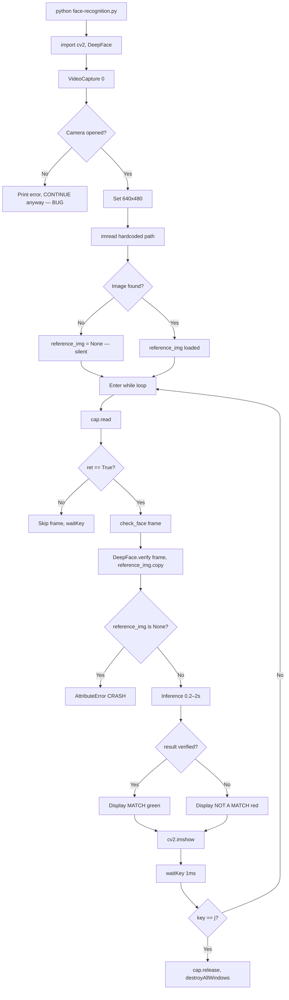

# FaceVerification — Complete Project Analysis Report

**Author:** Technical Audit  
**Date:** 2026-10-12  
**Branch:** feature/faceverification-modernization  
**Analyst:** Claude Sonnet 4.6

---

## 1. Executive Summary

The FaceVerification project is a minimal Python prototype (~44 lines) that opens a webcam feed and compares each captured frame against a hardcoded reference image using the DeepFace library. The system displays "MATCH" or "NOT A MATCH" on the video window.

**Current state:** The application **cannot run** in its current form because:
1. The reference image path is hardcoded to `/Users/joshua/Desktop/Personal/referenceimage2.jpg` — a macOS path that does not exist on this Windows machine or in the repository.
2. DeepFace and TensorFlow are **not installed** in the current environment.
3. The installed OpenCV variant is `opencv-python-headless`, which cannot display GUI windows (`cv2.imshow` will fail silently or raise an error).

Before any improvement work begins, these three blockers must be resolved.

---

## 2. Original Project Overview

| Property | Value |
|---|---|
| Repository | https://github.com/TechieTojin/FaceVerification |
| Language | Python |
| Lines of code | 44 |
| Entry point | `face-recognition.py` |
| Libraries | `opencv-python`, `deepface`, `tensorflow`, `keras` |
| Platform originally developed on | macOS (inferred from path `/Users/joshua/…`) |
| Reference image | Hardcoded absolute path — **missing** |
| Tests | None |
| Configuration files | None |
| Virtual environment | None |
| .gitignore | None |
| requirements.txt | None |

---

## 3. Repository Structure

```
FaceVerification/
├── face-recognition.py      # Entire application (44 lines)
├── README.md                # Basic usage description
└── docs/                    # Created during this audit
    ├── PROJECT_ANALYSIS_REPORT.md
    ├── CODE_WALKTHROUGH.md
    ├── ISSUES_AND_RISKS.md
    ├── IMPROVEMENT_ROADMAP.md
    ├── SETUP_GUIDE.md
    └── TEST_PLAN.md
```

No models, no datasets, no reference images, no configuration, no tests, no virtual environment are present in the repository.

---

## 4. Existing Technology Stack

| Library | Purpose | Status |
|---|---|---|
| `opencv-python` | Webcam capture, frame display, text overlay | `opencv-python-headless 5.0.0.93` installed — **headless variant, no GUI** |
| `deepface` | Face verification via neural network | **Not installed** |
| `tensorflow` | Backend for DeepFace models | **Not installed** |
| `keras` | High-level model API (used by TensorFlow) | **Not installed** |
| `numpy` | Array operations | `2.2.6` installed |
| `pillow` | Image I/O (DeepFace dependency) | `12.1.1` installed |

---

## 5. Complete Code Explanation

### `face-recognition.py` — full line-by-line analysis

**Lines 1–2: Imports**
```python
import cv2
from deepface import DeepFace
```
OpenCV is imported for camera access and image display. DeepFace provides the face verification API.

**Lines 5–7: Camera initialisation**
```python
cap = cv2.VideoCapture(0)
if not cap.isOpened():
    print("Error: Could not open camera.")
```
Opens camera index 0 (default webcam). If the camera fails to open, an error is printed but execution **continues** — this is a bug: the script will crash later when `cap.read()` is called.

**Lines 9–10: Resolution setting**
```python
cap.set(cv2.CAP_PROP_FRAME_WIDTH, 640)
cap.set(cv2.CAP_PROP_FRAME_HEIGHT, 480)
```
Requests 640×480 resolution. The camera driver may ignore these values.

**Lines 13–14: Reference image loading**
```python
reference_img = cv2.imread(
    "/Users/joshua/Desktop/Personal/referenceimage2.jpg")
```
Loads reference image from a hardcoded macOS path. On any other machine this returns `None`. No error is raised at this point — `cv2.imread` silently returns `None` for missing files.

**Lines 17–22: `check_face` function**
```python
def check_face(frame):
    try:
        result = DeepFace.verify(frame, reference_img.copy())
        return result['verified']
    except ValueError:
        return False
```
| Attribute | Value |
|---|---|
| Input | `frame` — numpy array from webcam |
| Output | `bool` — True if faces match |
| DeepFace model | Default (VGG-Face) |
| Detector | Default (opencv Haar cascade) |
| Distance metric | Default (cosine) |
| Threshold | Default (model-specific) |
| Exception handling | Only catches `ValueError` — other exceptions propagate and crash the app |

Critically: `reference_img.copy()` will raise `AttributeError: 'NoneType' object has no attribute 'copy'` when the reference image is missing.

**Lines 25–40: Main loop**
```python
while True:
    ret, frame = cap.read()
    if ret:
        face_match = check_face(frame)
        ...
    key = cv2.waitKey(1)
    if key == ord("j"):
        break
```
Captures frames in an infinite loop. **Every single frame** is passed to DeepFace — there is no throttling. DeepFace inference takes 0.2–2 seconds depending on hardware, so the UI will freeze constantly. The exit key is `j` (not the conventional `q` or ESC).

**Lines 43–44: Cleanup**
```python
cap.release()
cv2.destroyAllWindows()
```
Correctly releases camera and windows — but only reached if the loop exits normally via the `j` key. Exceptions or SIGINT will skip this cleanup.

---

## 6. Current Architecture

```
face-recognition.py (monolith)
│
├── Global state: cap (VideoCapture), reference_img (ndarray or None)
│
├── check_face(frame) → bool
│   └── DeepFace.verify(frame, reference_img)
│
└── Main loop
    ├── cap.read() → frame
    ├── check_face(frame) [BLOCKING — runs every frame]
    ├── cv2.putText()
    ├── cv2.imshow()
    └── cv2.waitKey(1) → exit on 'j'
```

Everything is in one flat script. No classes, no modules, no configuration, no error recovery.

---

## 7. End-to-End Execution Workflow



---

## 8. Face Verification Algorithm

DeepFace (default settings) uses:

| Step | Implementation |
|---|---|
| Face detection | OpenCV Haar cascade |
| Face alignment | RetinaFace-style 5-point (if using RetinaFace backend) |
| Feature extraction | VGG-Face (default) |
| Distance metric | Cosine similarity |
| Verification threshold | 0.40 (cosine, VGG-Face default) |

The pipeline:
1. Detect face bounding box in both images.
2. Align and crop to 224×224 (VGG-Face input size).
3. Run CNN — produce 4096-dimensional embedding.
4. Compute cosine distance between embeddings.
5. If distance < threshold → MATCH.

---

## 9. Development Environment Assessment

| Item | Status |
|---|---|
| OS | Windows 11 Pro 10.0.26200 |
| Python | 3.10.0 |
| pip | 21.2.3 |
| Virtual environment | None |
| opencv-python | `opencv-python-headless 5.0.0.93` — headless, no GUI |
| deepface | **Not installed** |
| tensorflow | **Not installed** |
| keras | **Not installed** |
| numpy | 2.2.6 |
| pillow | 12.1.1 |

**TensorFlow compatibility note:** TensorFlow 2.x supports Python 3.10. Recommended: `tensorflow==2.15.0` (last stable CPU-friendly release before 2.16's Keras 3 breaking changes). DeepFace 0.0.93 is compatible with tf 2.15.

---

## 10. Dependency Compatibility

Recommended pinned versions for Python 3.10 on Windows 11:

```
opencv-python==4.10.0.84      # Full build with GUI
deepface==0.0.93
tensorflow==2.15.0
tf-keras==2.15.1              # Required by deepface with tf 2.15+
numpy==1.26.4                 # tf 2.15 is incompatible with numpy 2.x
pillow==10.4.0
```

**Critical:** numpy 2.2.6 is installed but TensorFlow 2.15 requires numpy < 2.0. This must be downgraded.

---

## 11. Original Application Test Results

| Test | Result | Reason |
|---|---|---|
| Script starts | **FAIL** | DeepFace not installed |
| Camera opens | **UNTESTABLE** | Import fails before camera code |
| Reference image loads | **FAIL** | Path hardcoded to non-existent macOS path |
| DeepFace initialises | **FAIL** | Not installed |
| MATCH scenario | **UNTESTABLE** | Prerequisites not met |
| NOT A MATCH scenario | **UNTESTABLE** | Prerequisites not met |
| Clean exit | **UNTESTABLE** | App cannot start |

No tests were fabricated. All failures are based on direct inspection of installed packages and the hardcoded path.

---

## 12. Code Quality Findings

| ID | Severity | Line | Issue |
|---|---|---|---|
| CQ-01 | Critical | 14 | Hardcoded absolute macOS path for reference image |
| CQ-02 | Critical | 6–7 | Camera open failure does not stop execution |
| CQ-03 | Critical | 19 | `reference_img.copy()` crashes if imread returned None |
| CQ-04 | High | 21 | Only `ValueError` caught; `AttributeError`, `OSError`, model errors all crash app |
| CQ-05 | High | 28 | DeepFace called on every frame — severe performance problem |
| CQ-06 | High | 1–44 | No virtual environment, requirements.txt, or .gitignore |
| CQ-07 | Medium | 39 | Exit key is `j` — non-standard, no ESC support |
| CQ-08 | Medium | 25 | Infinite loop with no timeout or watchdog |
| CQ-09 | Medium | — | No logging — errors silently swallowed |
| CQ-10 | Medium | — | No type hints or docstrings |
| CQ-11 | Low | — | No face detected case returns False silently |
| CQ-12 | Low | — | Multiple faces in frame — undefined behaviour |

---

## 13. Bugs and Technical Debt

### Bug 1 (Critical): App continues after camera failure
**Root cause:** `if not cap.isOpened(): print(...)` does not exit.  
**Impact:** `cap.read()` returns `(False, None)` every iteration; app loops indefinitely showing nothing.

### Bug 2 (Critical): NoneType crash from missing reference image
**Root cause:** `cv2.imread` returns `None` for missing files; `.copy()` on `None` raises `AttributeError`.  
**Impact:** Application crashes immediately on first frame.

### Bug 3 (High): Every frame sent to DeepFace
**Root cause:** No throttle or interval — `check_face` called on each `cap.read()`.  
**Impact:** At ~0.5s per inference, effective frame rate is ~2 FPS; UI is frozen most of the time.

### Bug 4 (High): opencv-python-headless cannot show windows
**Root cause:** Headless build omits Qt/GTK display backend.  
**Impact:** `cv2.imshow` raises `cv2.error` or silently fails.

---

## 14. Performance Assessment

| Operation | Estimated time |
|---|---|
| DeepFace.verify (CPU, VGG-Face) | 0.3–2.0 s per call |
| Frame capture | ~1 ms |
| Text overlay + imshow | ~1 ms |
| **Effective frame rate** | **0.5–3 FPS** |

The application provides a nearly unusable user experience because verification blocks the display loop. A separate thread or process for inference is required.

---

## 15. Machine Learning Model Assessment

| Model | Accuracy (LFW) | Size | Speed (CPU) | Notes |
|---|---|---|---|---|
| VGG-Face (default) | ~98.4% | 580 MB | Slow | Old, heavy |
| FaceNet | ~99.6% | 90 MB | Medium | Good balance |
| ArcFace | ~99.8% | 250 MB | Medium | Best accuracy |
| SFace | ~99.0% | 37 MB | Fast | Lightweight, OpenCV-native |
| Facenet512 | ~99.6% | 90 MB | Medium | FaceNet with 512-dim embedding |

*Benchmark figures are from published DeepFace documentation and cited LFW benchmarks — not measured on this hardware.*

**Recommendation:** Use `ArcFace` with `retinaface` detector for best accuracy, or `SFace` with `ssd` for speed. Both are available via DeepFace.

---

## 16. Security and Privacy Assessment

### Critical Security Issues

| Risk | Severity | Description |
|---|---|---|
| No liveness detection | Critical | A printed photo or video replay will match — trivial spoofing |
| Reference image in plain filesystem | High | No encryption or access control |
| Hardcoded path with real person's name ("joshua") | High | Reveals user identity in source code |
| No verification attempt limits | High | Unlimited guessing attempts |
| No consent mechanism | High | Silently captures and processes biometric data |
| Exception swallowing | Medium | Security failures may be hidden |

### Liveness Detection
The current code has **zero** liveness detection. A photo of the reference person held in front of the camera will produce a MATCH. This makes the system unsuitable for any real authentication use case.

Options for liveness:
1. **Passive PAD** (e.g., FaceAntiSpoofing models) — recommended
2. **Blink/movement challenge** — low bar but better than nothing
3. **Depth sensor** — requires hardware

---

## 17. Recommended Architecture (Version 2.0)

**Recommendation: Option A — Python desktop application with modular structure**

Rationale: The project is a local desktop prototype. A web backend would add unnecessary complexity for the current use case.

```
FaceVerification/
├── app/
│   ├── __init__.py
│   ├── camera/
│   │   └── capture.py          # VideoCapture lifecycle management
│   ├── detection/
│   │   └── detector.py         # Face detection and alignment
│   ├── verification/
│   │   └── verifier.py         # DeepFace wrapper, async inference
│   ├── liveness/
│   │   └── liveness.py         # Presentation attack detection
│   ├── ui/
│   │   └── display.py          # OpenCV window, overlay, HUD
│   └── utils/
│       ├── config.py            # Settings loading from .env / config.yaml
│       └── logger.py            # Structured logging
├── config/
│   └── config.yaml              # Model, threshold, camera settings
├── reference/
│   └── .gitkeep                 # Reference images (gitignored)
├── tests/
│   ├── test_camera.py
│   ├── test_verification.py
│   └── test_liveness.py
├── docs/
├── .env.example
├── .gitignore
├── requirements.txt
└── README.md
```

---

## 18. Proposed Features by Version

### Version 1.1 — Stabilisation (Priority 1)
- [ ] Fix hardcoded path → configurable via env var or CLI arg
- [ ] Install correct dependencies with pinned versions
- [ ] Replace headless OpenCV with full GUI build
- [ ] Handle camera failure with proper exit
- [ ] Handle missing reference image with clear error
- [ ] Broaden exception handling in `check_face`
- [ ] Add basic logging
- [ ] Add `.gitignore` and `requirements.txt`

### Version 1.2 — Verification improvements
- [ ] Run DeepFace in separate thread (non-blocking UI)
- [ ] Display last N frame results for stability (smooth flicker)
- [ ] Add configurable model and threshold
- [ ] Add FPS counter to HUD
- [ ] Support multiple reference images

### Version 1.3 — Security
- [ ] Integrate passive liveness detection model
- [ ] Limit verification attempts per session
- [ ] Encrypt reference embeddings at rest
- [ ] Add user consent prompt on startup

### Version 2.0 — Modern application
- [ ] Modular architecture as described above
- [ ] User enrolment workflow
- [ ] Multi-user support
- [ ] Configuration UI
- [ ] Proper installer / packaging

---

## 19. Implementation Priorities

| Priority | Task | Effort |
|---|---|---|
| 1 | Create `.gitignore` and `requirements.txt` | 30 min |
| 2 | Fix hardcoded reference image path | 15 min |
| 3 | Fix camera failure handling | 15 min |
| 4 | Install correct dependencies | 1–2 hr |
| 5 | Replace headless OpenCV | 30 min |
| 6 | Add threaded inference | 2 hr |
| 7 | Add liveness detection | 4–8 hr |

---

## 20. Testing Strategy

See `TEST_PLAN.md` for detailed test cases.

**Approach:**
- Unit tests for `check_face`, camera lifecycle, and config loading using `pytest`
- Mock DeepFace calls to avoid heavy model downloads in CI
- Manual testing checklist for webcam and live face scenarios

---

## 21. Risks and Limitations

| Risk | Likelihood | Impact | Mitigation |
|---|---|---|---|
| numpy/tensorflow version conflict | High | Blocks execution | Pin numpy==1.26.4 |
| DeepFace model download (~580 MB) | Certain | Slow first run | Cache models, pre-download |
| Windows GPU driver issues | Medium | Slow inference | Default to CPU |
| Liveness detection accuracy | Medium | Security weakness | Use trained PAD model |
| opencv-headless incompatibility | High | No display | Reinstall opencv-python |

---

## 22. Final Recommendations

1. **Do not use this system for real authentication** in its current state — it has no liveness detection and is trivially spoofable.
2. **Fix the three critical blockers first:** dependencies, reference image path, headless OpenCV.
3. **Thread the inference** before any other feature work — the blocking loop makes the app unusable.
4. **Add passive liveness detection** before claiming any security value.
5. **Never commit real face images** to the repository.
6. **Consider ArcFace** instead of VGG-Face for meaningfully better accuracy.
